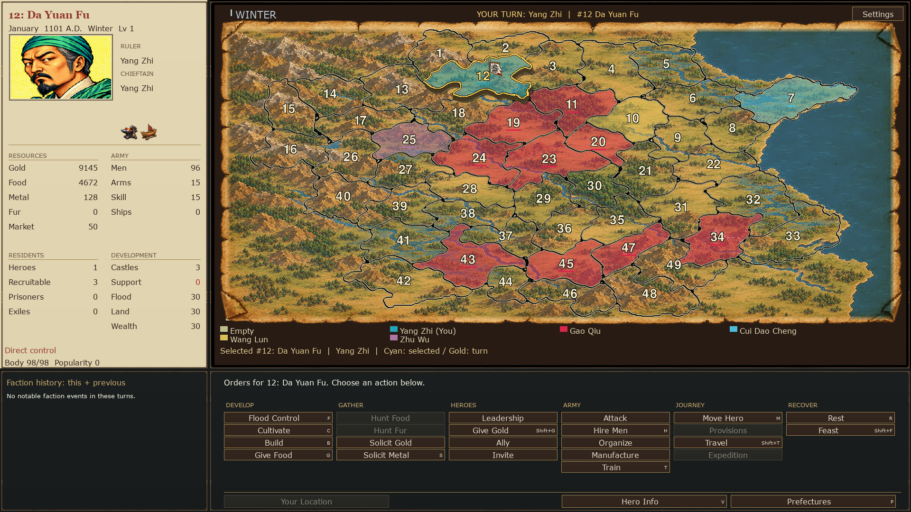
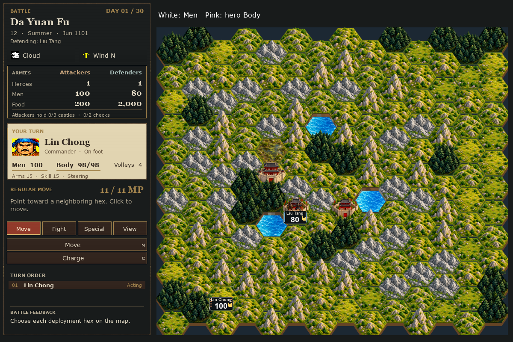

# Bandit Kings of Ancient China

A turn-based strategy game inspired by the classic Bandit Kings of Ancient
China. Lead a band of outlaws, recruit heroes, swear brotherhood, and build a
stronghold. Manage your lands and supplies, command armies in tactical battles,
and grow your reputation until you can challenge Gao Qiu.

Choose between the **Original look** and **New look** when you launch the game.
The screenshots below show the New look.

## Download and install

Get the game from [GitHub Releases](https://github.com/rillard/bkoac-release/releases).
The packaged game includes everything needed to run; you do not need to install
Python or Pygame.

| Your computer | Latest download | Installation |
| --- | --- | --- |
| macOS — Apple Silicon (M-series) | [Download DMG](https://github.com/rillard/bkoac-release/releases/latest/download/BKOAC-macOS-arm64.dmg) | Open the DMG, drag **Bandit Kings of Ancient China** into **Applications**, then open it from there. |
| Windows — 64-bit (x64) | [Download ZIP](https://github.com/rillard/bkoac-release/releases/latest/download/BKOAC-Windows-x64.zip) | Extract the entire ZIP, open the **Bandit Kings of Ancient China** folder, and run **Bandit Kings of Ancient China.exe**. Keep the executable and its support files together. |

Use the DMG or ZIP listed above, rather than GitHub's **Source code** archives.

## How to play

Read the [Play Guide](docs/QUICK_START_GUIDE.md) for your first year, settling a
home, managing heroes and Loyalty, and building toward victory.

## Report a problem

[Report a bug](https://github.com/rillard/bkoac-release/issues/new) with your game
version, operating system, what happened, and what you expected. Include a
screenshot or game recording if it helps explain the problem.

---
